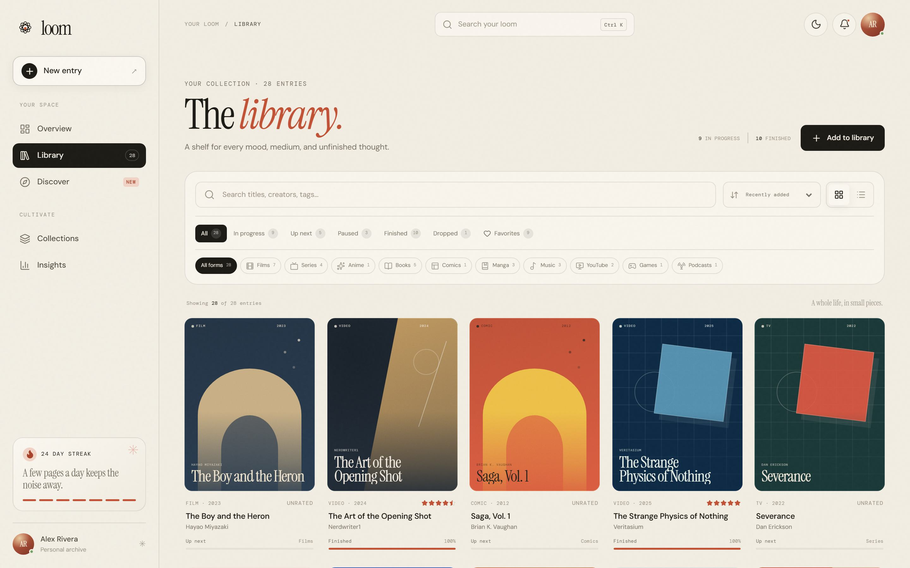

# Loom

A quiet archive for everything you watch, read, listen to, and play — films,
series, anime, books, comics, manga, music, videos, games, podcasts. No
accounts, no feed, no algorithm.



## What it does

- **One library, ten media types.** Each type carries its own progress unit —
  minutes for a film, pages for a book, issues for a comic, seasons for a series.
- **Search the catalog to fill in a form.** Type a title and Loom pulls the real
  year, creator, synopsis, and cover art from a keyless public API.
- **Honest time tracking.** Every progress change writes to a single day-by-day
  log, so the streaks, charts, and totals on the dashboard reconcile with each
  other rather than being decorative.
- **Collections.** Shelve titles across types — "Sunday, slowly" can hold a film
  and a novel. Collections are editable and removable.
- **Discover, Insights, Player.** Curated starting points, a read of your own
  habits, and a focused reading/listening surface with a session timer.
- **Keyboard-first.** `Ctrl/Cmd+K` for the palette, `/` to filter, `n` for a new
  entry, `1`–`5` to jump between pages, `?` for the full list.
- **Two themes, four breakpoints.** Light "paper" and dark "midnight". The phone
  layout is a real layout — bottom sheets, 44px targets, safe-area insets — not
  a squished desktop.

## Where the data lives

In `localStorage` on the device, under `loom.library.v1`. Nothing is sent
anywhere except the search queries you type into the catalog lookup. Export and
import are a JSON file you own.

Catalog sources, all free and keyless: OpenLibrary (books, comics), Wikipedia
(films, series, games), iTunes Search (music, podcasts), YouTube oEmbed (video
links), AniList (anime, manga).

## Running it

```bash
npm install
npm run dev      # http://localhost:5173
npm run build    # type-check + production bundle
npm run qa       # 17 browser checks: layout, search, progress, theme, palette
npm run qa:chrome # 18 checks against the desktop window chrome
```

## Desktop app

`src-tauri/` holds a Tauri v2 shell: frameless window with a drawn title bar,
native menu bar with accelerators, single-instance refocus, remembered window
geometry, and OS notifications when something finishes out of sight.

The build runs on GitHub Actions (`.github/workflows/desktop.yml`) because the
runner already ships Rust, the MSVC linker, and WebView2 — no local toolchain
needed. Trigger it from the Actions tab, or push a `v*` tag to publish the
installers to a release.

To build locally instead, `desktop-setup.ps1` installs the toolchain to
`D:\dev` (~9 GB, needs one elevated run), then:

```bash
npm run desktop:dev     # hot reload
npm run desktop:build   # NSIS .exe + MSI under src-tauri/target/release/bundle
```

## Fonts

Instrument Serif, DM Sans, and DM Mono are self-hosted from `public/fonts/` so
the desktop build is identical offline. All three are licensed under the SIL Open
Font License.
